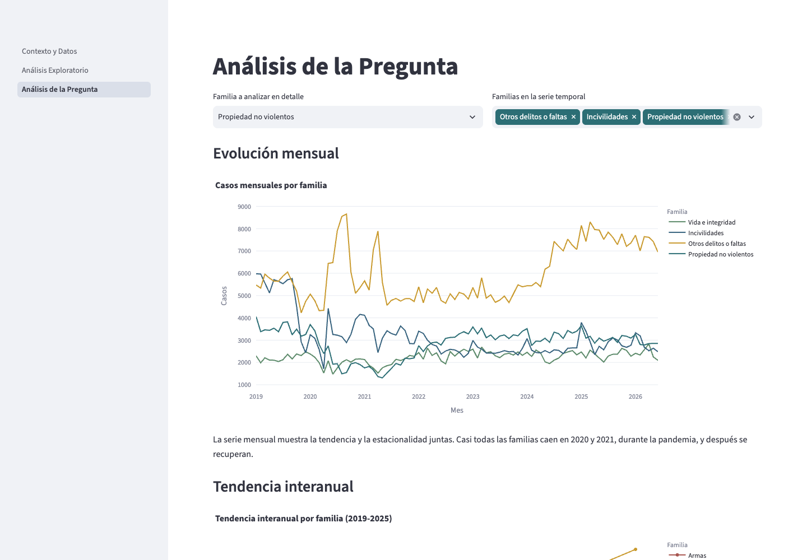
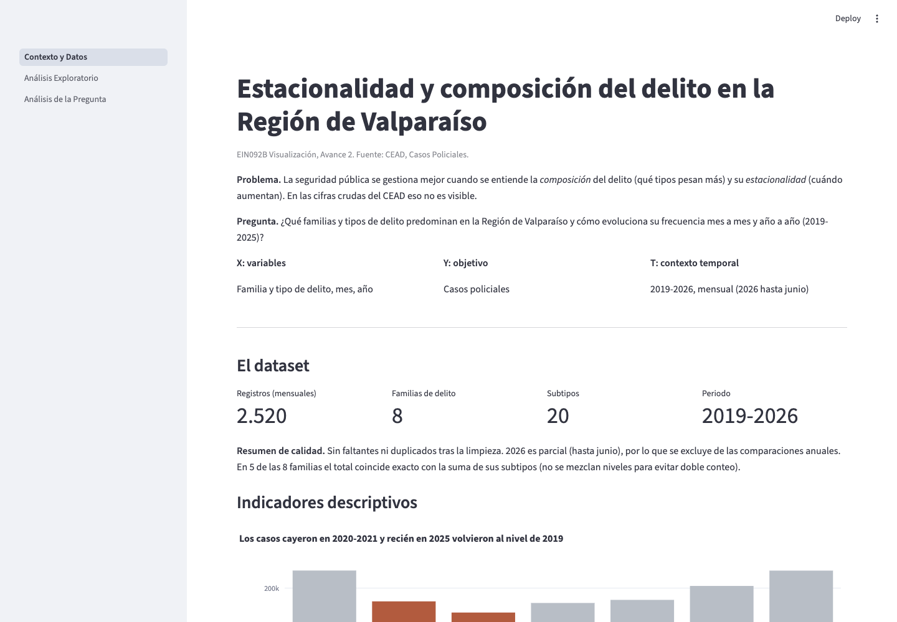
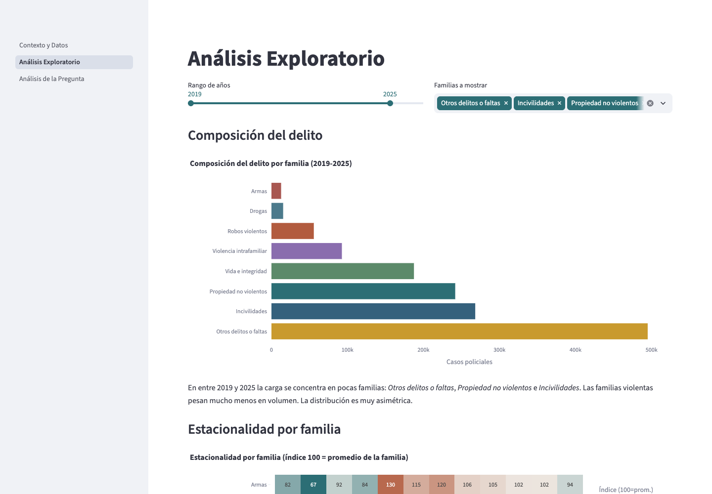
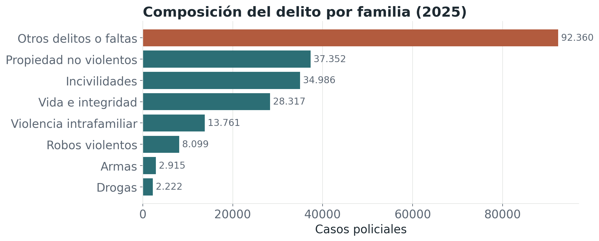
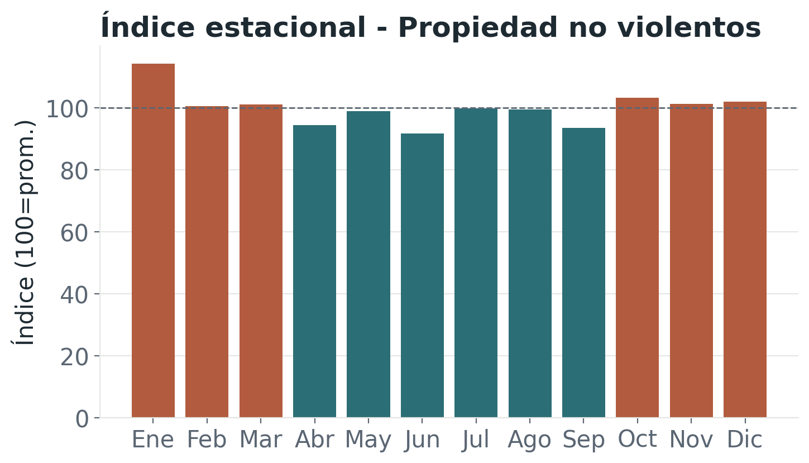
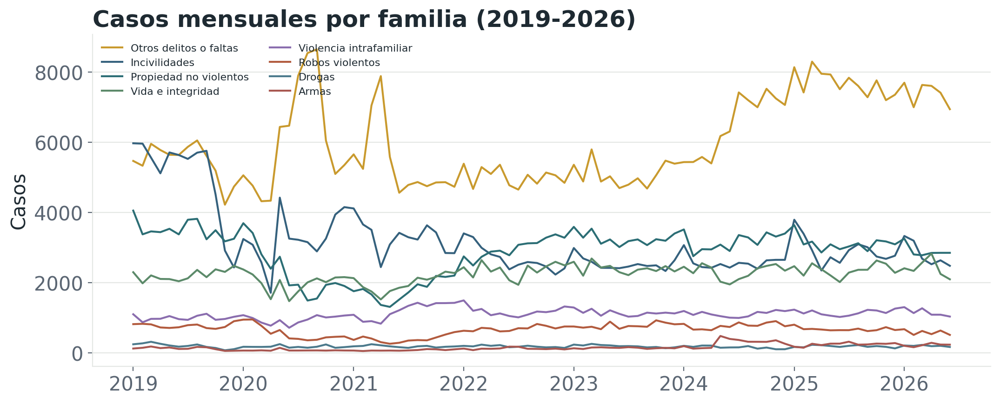
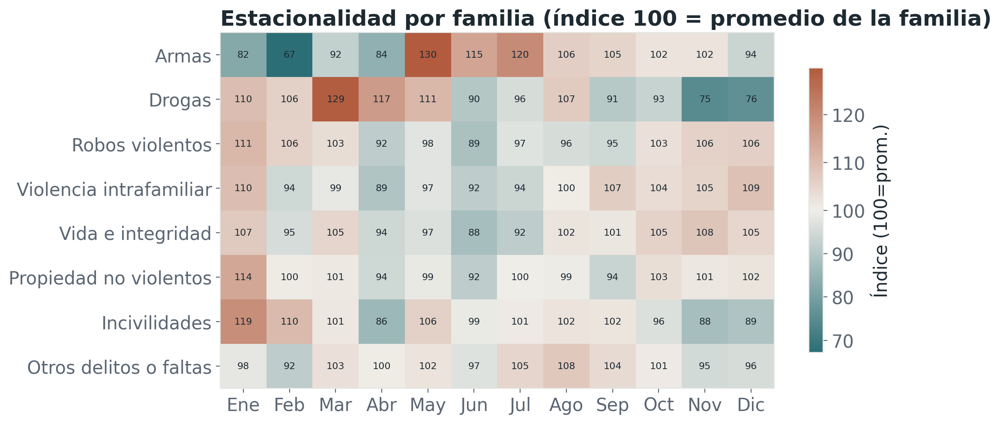
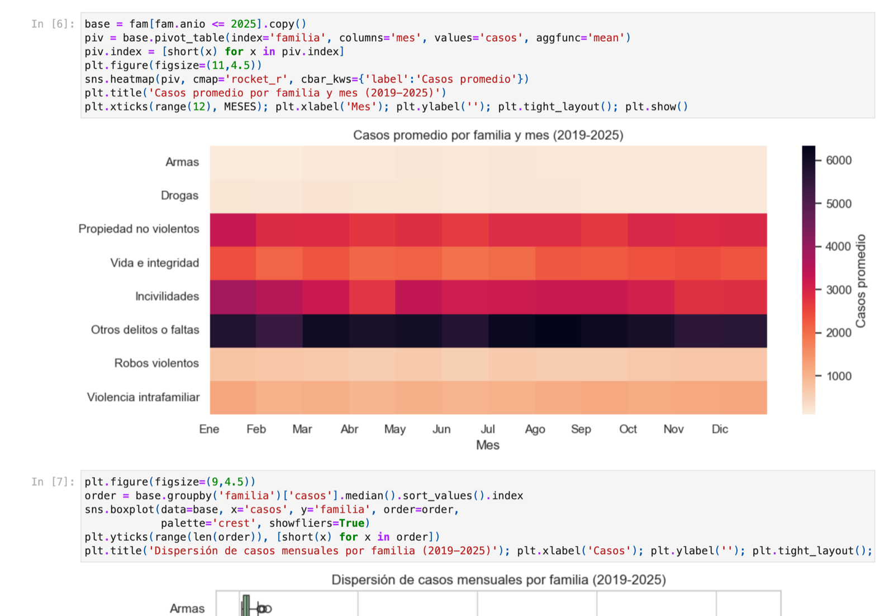
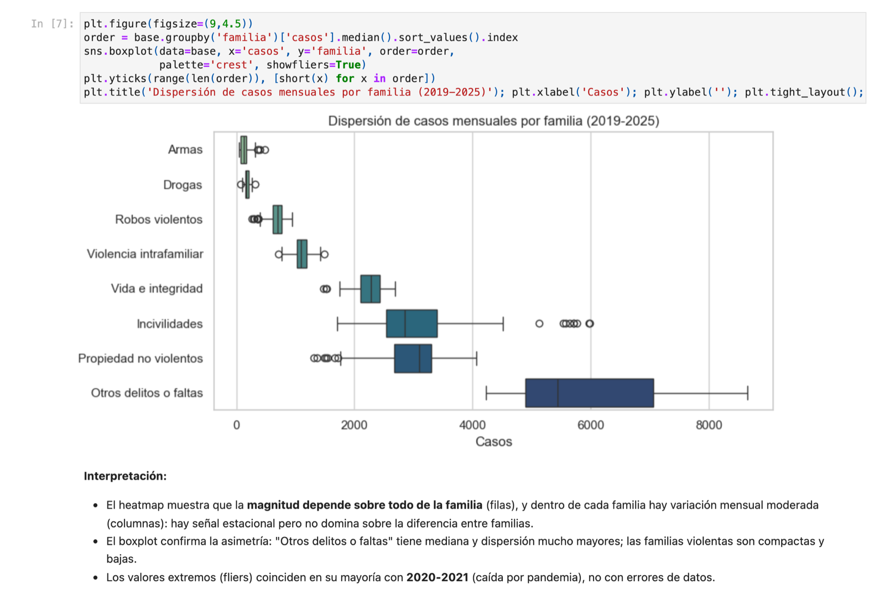

# Estacionalidad y composición del delito en la Región de Valparaíso

Proyecto del curso **EIN092B Visualización** (USM, 2026-2). Producto de datos incremental que transforma las estadísticas de Casos Policiales del CEAD en una narrativa visual sobre qué tipos de delito predominan en la Región de Valparaíso y cómo varían mes a mes y año a año.

**Stack:** Python, pandas, Plotly y Streamlit. **Datos:** CEAD, 2.520 registros mensuales, 8 familias y 20 subtipos de delito, 2019 a 2026.



| Contexto y datos | Análisis exploratorio |
|---|---|
|  |  |

## Integrantes
- Juan Domenech
- Sebastian Miranda

## Problema
La seguridad pública se gestiona mejor cuando se entiende la **composición** del delito (qué tipos pesan más) y su **estacionalidad** (cuándo aumentan). Estas dos dimensiones no siempre son visibles en las cifras crudas del CEAD, que se publican como tablas extensas y poco legibles.

## Motivación
Visibilizar patrones estacionales y de composición permite focalizar prevención y patrullaje en los meses y tipos de delito de mayor carga. Es información directamente útil para decisiones municipales de seguridad.

## Pregunta inicial
¿Qué familias y tipos de delito predominan en la Región de Valparaíso y cómo evoluciona su frecuencia mes a mes y año a año durante el período 2019-2025?

## Alcance
- **Región / contexto**: Región de Valparaíso (nivel regional agregado, no comunal).
- **Unidad de observación**: registro mensual por tipo de delito (año x mes x tipo de delito).
- **Periodo**: 2019-2026 (2026 parcial, hasta junio; las comparaciones anuales usan 2019-2025).
- **Medida**: Casos Policiales (frecuencia). No incluye la cifra negra (delitos no denunciados).
- **Fuera de alcance**: desglose por comuna y análisis causal.

## Estructura X, Y, T
- **X (variables disponibles)**: familia de delito, tipo de delito, mes, año.
- **Y (objetivo)**: casos policiales; indicadores derivados como participación porcentual por familia, variación interanual e índice estacional.
- **T (contexto temporal)**: 2019-2026 (2026 parcial, hasta junio), granularidad mensual.

## Fuente del dataset
Centro de Estudios y Análisis del Delito (CEAD), Subsecretaría de Prevención del Delito. Portal: https://data.cead.spd.gob.cl
Reporte: Casos Policiales, Región de Valparaíso, temporalidad mensual.

## Descripción de los datos
Cada fila corresponde a la cantidad de casos policiales registrados para un tipo de delito en un mes y año dados, en la Región de Valparaíso. Variables principales: año, mes, familia de delito, tipo de delito, casos. El archivo crudo del CEAD incluye un bloque de metadatos en la parte superior que debe descartarse durante la limpieza (ver `src/data_prep.py`).

## Estructura del repositorio
```
proyecto-viz-delitos/
├── data/
│   ├── raw/          export original del CEAD (no versionado por peso)
│   └── processed/    datasets limpios (mensual y anual, formato largo)
├── notebooks/
│   ├── 01_exploracion.ipynb   primeras vistas (Avance 1)
│   └── 02_eda.ipynb           EDA completo (Avance 2)
├── src/
│   ├── data_prep.py  limpieza y transformación del export CEAD
│   └── viz.py        funciones de gráficos reutilizables (notebook + app)
├── app/
│   ├── app.py                 punto de entrada y menú de navegación
│   └── pages/
│       ├── 1_Contexto.py      Página 1: Contexto y Datos
│       ├── 2_EDA.py           Página 2: Análisis Exploratorio
│       └── 3_Analisis.py      Página 3: Análisis de la Pregunta
├── figures/          gráficos exportados
├── .streamlit/       tema de la app (color de los controles)
├── requirements.txt
├── README.md
└── .gitignore
```

## Gráficos

Algunos de los gráficos del análisis (exportados en `figures/deck/`):

| Composición por familia | Índice estacional |
|---|---|
|  |  |
| **Serie mensual** | **Casos por familia y mes** |
|  |  |

## El notebook

El análisis exploratorio está en [notebooks/02_eda.ipynb](notebooks/02_eda.ipynb), guardado con sus resultados para que se vea directo en GitHub. Dos celdas como ejemplo:





## Cómo obtener los datos
En https://data.cead.spd.gob.cl, sección Casos Policiales: filtrar **Región de Valparaíso**, años **2019-2026**, temporalidad por **Mes**, con los tipos de delito desagregados, y exportar. El CEAD entrega un `.xls` que en realidad es HTML; `src/data_prep.py` lo parsea (maneja el formato numérico chileno y el bloque de metadatos).

## Cómo reproducir
1. `pip install -r requirements.txt`
2. Colocar el export del CEAD en `data/raw/reportes_mensual.xls`.
3. Ejecutar `python src/data_prep.py` para generar los datasets limpios en `data/processed/` (mensual y anual).
4. EDA: abrir `notebooks/02_eda.ipynb`.
5. Aplicación: `streamlit run app/app.py`.

## Aplicación (Streamlit)
Tres páginas con propósito analítico diferenciado:
1. **Contexto y Datos**: problema, pregunta, X/Y/T, tamaño y calidad del dataset.
2. **Análisis Exploratorio**: composición, estacionalidad (heatmap), dispersión (boxplot) y estadísticas por familia (media, mediana, desviación, asimetría y meses atípicos por regla IQR), con filtros de año y familia.
3. **Análisis de la Pregunta**: evolución mensual, tendencia interanual, índice estacional, variación, tipos de delito (subtipos) de la familia elegida y correlación entre familias, con selección de familia.

Visualizaciones interactivas hechas con Plotly (barras, líneas, heatmap, boxplot). Cada gráfico se acompaña de su interpretación.

## Estado
- **Avance 1**: formulación del problema, pregunta, datos y repositorio.
- **Avance 2**: EDA (`notebooks/02_eda.ipynb`) y aplicación interactiva en Streamlit (`app/`).
